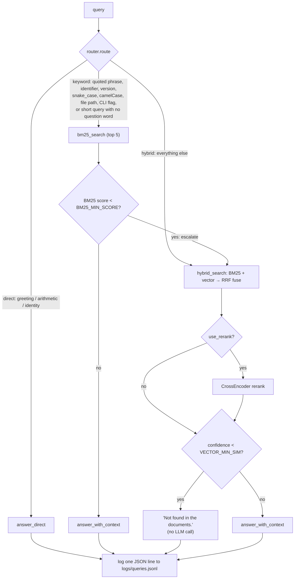

# AdaptiveRAG

A retrieval-augmented generation pipeline built from scratch — no LangChain,
LlamaIndex, or Haystack. A router classifies each query *before* any
retrieval happens, so cheap queries (greetings, arithmetic, "who are you")
skip retrieval entirely, exact-lookup-shaped queries (ticket IDs, version
numbers, file paths, quoted phrases) try BM25 first, and everything else
goes through hybrid (BM25 + vector) search fused with Reciprocal Rank
Fusion, with an optional cross-encoder reranking pass. A confidence
threshold on the retrieval side means the pipeline says "Not found in the
documents" instead of guessing when nothing relevant was actually retrieved.

Built as a from-scratch learning project — every piece (chunking, FAISS/BM25
indexing, RRF fusion, routing, confidence gating) is implemented directly
with `sentence-transformers`, `faiss-cpu`, `rank_bm25`, and `pypdf`, not a
RAG framework, so each part is easy to point at and explain.

## Architecture



`answer_with_context` also normalizes an LLM reply of exactly `NOT_FOUND`
to the same "Not found in the documents." message, so a confidence miss
and a model-side miss look identical to the caller.

## Setup

```bash
# Use Python 3.10 (faiss-cpu / torch wheels aren't available for newer versions yet)
py -3.10 -m venv venv

# Windows
venv\Scripts\activate
# macOS/Linux
source venv/bin/activate

pip install -r requirements.txt

cp .env.example .env
# then edit .env: set LLM_PROVIDER, LLM_MODEL, API_KEY (Ollama needs no key)
```

This project uses Ollama as its LLM provider (see [DECISIONS.md](DECISIONS.md)).
Install Ollama separately and pull a model before running anything that
calls the LLM:

```bash
ollama pull llama3.1
```

## Running each step

```bash
# 1. Add PDFs to data/raw/, then chunk them
python -m src.ingest            # writes data/index/chunks.json

# 2. Build the FAISS vector index and BM25 index
python -m src.indexer           # writes data/index/faiss.index, data/index/bm25.pkl

# 3. Run the test suite
pytest -v

# 4. Evaluate against eval/questions.json (40+ real, user-supplied questions)
python -m src.eval              # writes eval/results.md, eval/to_grade.csv
python -m src.eval --llm-judge  # also adds an LLM-judged correctness score

# 5. Launch the UI
streamlit run app.py
```

## Evaluation

*Pending real evaluation data.* `eval/results.md` hasn't been generated yet:
`data/raw/` has no real PDFs indexed, and `eval/questions.json` (40+
real questions) hasn't been supplied. Per this project's rule against
inventing evaluation numbers, no placeholder table is shown here — once
both exist, running the three commands above (`ingest` → `indexer` →
`eval`) will produce a real `eval/results.md`, and this section gets
replaced with that table.

## What worked / what didn't

*Pending real evaluation results* — see above. This section will be
written from the actual `eval/results.md` output once it exists, not
guessed in advance.

## Limitations

- No real document corpus is indexed yet; every test in this repo runs
  against small synthetic fixtures built in-memory for that test.
- Chunking's paragraph-boundary detection depends on the PDF text
  extraction preserving blank-line breaks, which many PDFs don't encode;
  in practice, chunking mostly falls through to the sentence-boundary
  step (see `DECISIONS.md`).
- Token counts are approximate (`word count × 1.3`), not an exact match
  for any specific model's tokenizer.
- `BM25_MIN_SCORE` and `VECTOR_MIN_SIM` are placeholders until
  `src.eval.tune_thresholds()` is run against real data.
- The router's patterns are heuristics, not a learned classifier — e.g. a
  mixed-case proper noun (like a product name) inside an otherwise
  conceptual question can trigger the `camel_case_token` keyword rule.
  This is tolerated by design: the keyword route escalates to hybrid
  automatically on a weak BM25 match.
- Reranking lazily loads `BAAI/bge-reranker-base` (~1GB); the first call
  that uses it is slow.
- Only one LLM provider is implemented (`ollama`); switching providers
  means implementing a new branch in `src/llm.py`, not just an env var.
- No authentication, concurrency control, or deployment hardening — this
  is a learning project, not a production service.

## Related work

- **[adaptive-rag-engine](https://pypi.org/project/adaptive-rag-engine/)**
  (PyPI) — a FastAPI service built on LangChain that dynamically routes
  each query to dense (FAISS + SentenceTransformers), sparse (BM25), or
  RRF-fused hybrid retrieval based on query analysis, followed by
  cross-encoder reranking and a confidence estimator, generating with
  Google Gemini.
- **[ArgusLens](https://github.com/R-Sreenivas-Raju/ArgusLens)** — a RAG
  system for banking document Q&A. A regex-based intent classifier routes
  each query down a deterministic path (rule-based extraction for
  structured questions like eligibility checks, no LLM involved) or an
  LLM path (query condensation, then BM25+FAISS hybrid retrieval fused
  with RRF via LangChain's `EnsembleRetriever`, then a BGE cross-encoder
  rerank, then a Gemini chain with chat memory).
- **[Augur](https://github.com/willgitdata/augur)** — a TypeScript
  (`@augur-rag/core`) adaptive retrieval layer sitting on top of a vector
  database. For each query it picks vector search, BM25, weighted
  hybrid, or vector-then-rerank using inexpensive query-feature
  heuristics, and returns an explainable routing trace (decision,
  reasons, timing) with every response.

**What this project does differently:** all three route *between*
retrieval strategies, but none appear to route *out of* retrieval
entirely — AdaptiveRAG adds a **direct route with no retrieval at all**
for queries that don't need the document corpus (greetings, arithmetic,
"what can you do"), so those never touch the index or spend retrieval
latency. It also adds an explicit **confidence-based fallback**: the
keyword route escalates to hybrid retrieval on a weak BM25 match, and the
hybrid/vector path returns "Not found in the documents" — without calling
the LLM at all — when retrieval confidence falls below a threshold, rather
than letting the LLM attempt an answer from weak context. These are
modest, specific additions on top of the same core idea (strategy
routing) these other projects already explore; see `eval/results.md`
(once generated from real data) for how the router actually compares to
each strategy run in isolation on this project's own test questions.

---

See [DECISIONS.md](DECISIONS.md) for the reasoning behind every choice
not pinned down by the project spec, logged step by step as the project
was built.
