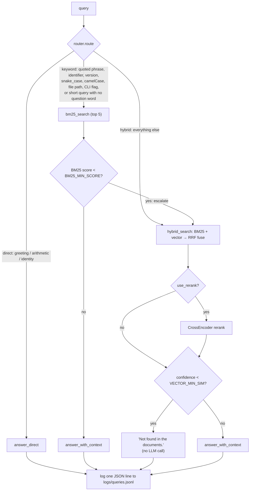

# AdaptiveRAG

A retrieval-augmented generation pipeline built from scratch — no LangChain,
LlamaIndex, or Haystack. A router classifies each query *before* any
retrieval happens, so cheap queries (greetings, arithmetic, "who are you")
skip retrieval entirely, exact-lookup-shaped queries (ticket IDs, version
numbers, file paths, quoted phrases) try BM25 first, and everything else
goes through hybrid (BM25 + vector) search fused with Reciprocal Rank
Fusion, with an optional cross-encoder reranking pass. A confidence
threshold on the retrieval side means the pipeline says "Not found in the
documents" instead of guessing when nothing relevant was actually retrieved.

Built as a from-scratch learning project — every piece (chunking, FAISS/BM25
indexing, RRF fusion, routing, confidence gating) is implemented directly
with `sentence-transformers`, `faiss-cpu`, `rank_bm25`, and `pypdf`, not a
RAG framework, so each part is easy to point at and explain.

## Architecture



`answer_with_context` also normalizes an LLM reply of exactly `NOT_FOUND`
to the same "Not found in the documents." message, so a confidence miss
and a model-side miss look identical to the caller.

## Setup

```bash
# Use Python 3.10 (faiss-cpu / torch wheels aren't available for newer versions yet)
py -3.10 -m venv venv

# Windows
venv\Scripts\activate
# macOS/Linux
source venv/bin/activate

pip install -r requirements.txt

cp .env.example .env
# then edit .env: set LLM_PROVIDER, LLM_MODEL, API_KEY (Ollama needs no key)
```

This project uses Ollama as its LLM provider (see [DECISIONS.md](DECISIONS.md)).
Install Ollama separately and pull a model before running anything that
calls the LLM:

```bash
ollama pull llama3.1
```

## Running each step

```bash
# 1. Add PDFs to data/raw/, then chunk them
python -m src.ingest            # writes data/index/chunks.json

# 2. Build the FAISS vector index and BM25 index
python -m src.indexer           # writes data/index/faiss.index, data/index/bm25.pkl

# 3. Run the test suite
pytest -v

# 4. Evaluate against eval/questions.json (40+ real, user-supplied questions)
python -m src.eval              # writes eval/results.md, eval/to_grade.csv
python -m src.eval --llm-judge  # also adds an LLM-judged correctness score

# 5. Launch the UI
streamlit run app.py
```

## Evaluation

Real run: 26 arXiv papers (NLP/LLM evaluation research, 2161 chunks),
55 user-written questions (6 general, 32 exact, 17 conceptual), local
`llama3.2:3b` via Ollama. Full numbers in [eval/results.md](eval/results.md).

**hit@5** (retrieved chunk matches the gold source/page; `general`
questions have no gold page and are excluded):

| Config | overall | conceptual | exact |
|---|---|---|---|
| direct | 0.00 | 0.00 | 0.00 |
| bm25 | 0.78 | 0.88 | 0.72 |
| vector | 0.63 | 0.76 | 0.56 |
| hybrid | 0.76 | 0.88 | 0.69 |
| hybrid+rerank | 0.76 | 0.88 | 0.69 |
| router | 0.76 | 0.88 | 0.69 |

`direct`'s 0.00 is expected (it never retrieves). BM25 edges out hybrid
specifically on `exact` questions (0.72 vs. 0.69) — fact/number lookups
favor literal keyword matching over semantic similarity, which is the
whole reason the router has a keyword route at all.

**Neighbor expansion** (added after the initial build to fix chunk-
boundary fragmentation; see `DECISIONS.md`) was measured the same way,
`hybrid` with and without it, over all 55 questions:

| Config | hit@5 overall | conceptual | exact | latency mean |
|---|---|---|---|---|
| hybrid | 0.76 | 0.88 | 0.69 | 14.3s |
| hybrid+neighbors | **0.80** | 0.88 | **0.75** | 16.2s |

The gain is concentrated entirely in `exact` questions (+0.06); `conceptual`
is unchanged. That matches the mechanism: a specific number or fact is
more likely to sit right at a chunk boundary than a broad conceptual
point is to need one. Cost is a modest latency/token increase from
sending each hit's neighboring chunks as extra context. Raw answers are
in `eval/to_grade_neighbors.csv` (not yet hand-graded for correctness —
hit@5 only confirms the right page was retrieved, not that the final
answer used it well, per the correctness section below).

**Correctness** (hand-graded against `expected_answer`, all 330
answers — 55 questions × 6 configs — via `eval/to_grade.csv`):

| Config | Correct | Score |
|---|---|---|
| bm25 | 29/55 | 53% |
| router | 27/55 | 49% |
| vector | 24/55 | 44% |
| hybrid | 24/55 | 44% |
| hybrid+rerank | 23/55 | 42% |
| direct | 5/55 | 9% |

**Correctness is well below hit@5 (42-53% vs. 63-78%).** Finding the
right chunk isn't enough: the grader marked an answer wrong whenever it
was a bare citation marker (`[2]`), a raw table dump instead of a
sentence, or only half of a two-part answer — all of which happened
with the right chunk sitting right there in context. The gaps between
search strategies (1-6 questions out of 55) are within noise at this
sample size; none is clearly better than the others on correctness,
even though hit@5 ranked them more distinctly.

One grading methodology note, found by cross-checking the flagged
"wrong numbers" against the actual PDFs: two were genuine model errors
(HaluEval: model said "30,000 samples per task," the paper says 10,000
per task/30,000 total; HELM: model said "14" or "42" core scenarios,
the paper says 16, unambiguously, a dozen times over). But a third
(ARES: model said "59.9" percentage points, graded wrong against an
expected answer of "59.3") turned out **not** to be a clean error —
the source paper itself states both 59.3 (abstract) and 59.9 (results
section) for the same figure. Grading against a single `expected_answer`
string can't catch a source paper's own internal inconsistency; this
affects at most 1 of 55 questions, not enough to change the ranking
above, but worth knowing before trusting any single-question grade too
literally.

## What worked / what didn't

**Worked:** The router correctly never escalated a genuinely strong
keyword match (escalation rate 0.00% in this run), and `direct` costs
almost nothing (mean latency 4.9s vs. 12-55s for anything touching
retrieval) while correctly never fabricating an answer to a real
document question (0.00 hit@5 is right, not a bug, for a route that
has no context to retrieve from).

**Didn't work, and why — the confidence gate let bad answers through
more often than it should have.** The threshold sweep
(`tune_thresholds()`, in `eval/results.md`) shows the current
`VECTOR_MIN_SIM=0.45` gives a **100% false-answer rate on genuinely
out-of-scope questions** when hybrid retrieval runs in isolation (via
`force_route`) — every one of the 6 `general` test questions cleared
the threshold and got an attempted answer instead of "Not found."
Looking at the *actual* answers in `to_grade.csv` explains why, and
it's more interesting than "the threshold is wrong":

- Asked **"What is the capital of France?"**, the `bm25` config
  answered `"Paris"` — correctly, but only because one of the papers
  contains a benchmark Q&A example (`"What is the capital of
  France?" → "Paris"`) almost verbatim. BM25 matched it on literal
  text overlap, not because the corpus is actually about France.
- Asked conversational questions ("Hi, how are you today?", "Can you
  write me a poem about the ocean?", "What's the weather in Mumbai?"),
  several configs retrieved chunks from papers *about* prompts,
  jailbreaks, and LLM-evaluation benchmarks — and then the model
  **completed or echoed the example prompt text it found**, rather
  than recognizing it as unrelated sample data and refusing. One `bm25`
  answer devolves into an unrelated all-caps "PRESIDENT OF THE UNITED
  STATES" rant about the C programming language — almost certainly a
  jailbreak-test string lifted straight from a retrieved chunk.
- `hybrid` sometimes just ignored the "answer only from context"
  instruction entirely and used its own general knowledge (writing an
  actual ocean poem, describing Mumbai's real climate) — a real
  instruction-following gap in a 3B local model, not a retrieval bug.
- `vector` alone was the most reliable refuser of the three forced
  single-method configs (correctly said "Not found" or gave a
  reasonable refusal on 5 of 6 general questions) — lexical/BM25
  matching was specifically what let irrelevant benchmark content leak
  through, since a corpus of *papers about evaluating LLMs* is, ironically,
  full of generic example questions that lexically resemble almost any
  casual query.

**Takeaway for an interview:** raising `VECTOR_MIN_SIM` alone won't
fully fix this — the deeper issue is that BM25 can retrieve
superficially relevant content from a domain-adjacent corpus (papers
*about* QA benchmarks and jailbreaks naturally contain QA- and
jailbreak-shaped text), and a 3B local model doesn't reliably resist
completing what it retrieves. A production fix would need either a
stricter "is this chunk's content actually relevant, or just
textually similar" check, or a larger/better-instructed model.

**The correctness grading confirms this quantitatively, not just
anecdotally.** On the 6 general (out-of-scope) questions specifically,
`direct` (no retrieval at all) got 5/6 correct, while `hybrid+rerank`
got 0/6 and the other retrieval-on configs got 1-3/6. Turning retrieval
on for a question that shouldn't need it made things *worse*, not
better — the same effect the threshold sweep found, now measured
against actual correctness rather than just a confidence number.

**A second, separate failure mode the correctness grading surfaced:**
even on real document questions where the right chunk *was* retrieved,
the model often answered with a bare citation marker, a raw table
pasted from the context, or only one half of a two-part question —
all marked wrong despite correct retrieval. This is exactly the kind
of failure neighbor expansion (added after the initial build; see
`DECISIONS.md`) targets for the "half of a two-part answer" case
specifically, by giving the model the adjacent chunk instead of a
hard page/chunk boundary cut.

**Latency numbers in `eval/results.md` should be read as rough orders
of magnitude, not a clean strategy comparison** — this run shared a
resource-constrained machine with other running applications, and
later configs (e.g. `router`, mean 54.8s) measurably slowed down under
memory pressure partway through the run, independent of the strategy
itself. The hit@5 numbers aren't affected by this (they don't depend
on wall-clock speed), only the latency/p95 columns are.

## Limitations

- The automated test suite still runs against small synthetic fixtures
  (not the real corpus) for speed and determinism; the real corpus is
  only exercised by `python -m src.eval` and manual use.
- Chunking's paragraph-boundary detection depends on the PDF text
  extraction preserving blank-line breaks, which many PDFs don't encode;
  in practice, chunking mostly falls through to the sentence-boundary
  step (see `DECISIONS.md`).
- Token counts are approximate (`word count × 1.3`), not an exact match
  for any specific model's tokenizer.
- `BM25_MIN_SCORE=5.0` and `VECTOR_MIN_SIM=0.45` are still the spec's
  placeholder values — `tune_thresholds()` has now run against real
  data (see Evaluation above) and shows neither threshold alone fixes
  false answers on out-of-scope questions; the root cause is retrieval
  returning superficially-matching but irrelevant content, not just a
  miscalibrated number. Raising `VECTOR_MIN_SIM` was not applied
  automatically, per this project's rule that the user decides.
- A corpus of papers *about* LLM evaluation/benchmarks/jailbreaks
  contains example Q&A pairs and adversarial prompt text as part of its
  normal content — retrieval can surface this for an unrelated query,
  and the local 3B model sometimes completes or echoes it instead of
  refusing. This is a property of this specific corpus choice, not a
  general flaw in the pipeline.
- The router's patterns are heuristics, not a learned classifier — e.g. a
  mixed-case proper noun (like a product name) inside an otherwise
  conceptual question can trigger the `camel_case_token` keyword rule.
  This is tolerated by design: the keyword route escalates to hybrid
  automatically on a weak BM25 match.
- Reranking lazily loads `BAAI/bge-reranker-base` (~1GB); the first call
  that uses it is slow.
- Only one LLM provider is implemented (`ollama`); switching providers
  means implementing a new branch in `src/llm.py`, not just an env var.
- No authentication, concurrency control, or deployment hardening — this
  is a learning project, not a production service.

## Related work

- **[adaptive-rag-engine](https://pypi.org/project/adaptive-rag-engine/)**
  (PyPI) — a FastAPI service built on LangChain that dynamically routes
  each query to dense (FAISS + SentenceTransformers), sparse (BM25), or
  RRF-fused hybrid retrieval based on query analysis, followed by
  cross-encoder reranking and a confidence estimator, generating with
  Google Gemini.
- **[ArgusLens](https://github.com/R-Sreenivas-Raju/ArgusLens)** — a RAG
  system for banking document Q&A. A regex-based intent classifier routes
  each query down a deterministic path (rule-based extraction for
  structured questions like eligibility checks, no LLM involved) or an
  LLM path (query condensation, then BM25+FAISS hybrid retrieval fused
  with RRF via LangChain's `EnsembleRetriever`, then a BGE cross-encoder
  rerank, then a Gemini chain with chat memory).
- **[Augur](https://github.com/willgitdata/augur)** — a TypeScript
  (`@augur-rag/core`) adaptive retrieval layer sitting on top of a vector
  database. For each query it picks vector search, BM25, weighted
  hybrid, or vector-then-rerank using inexpensive query-feature
  heuristics, and returns an explainable routing trace (decision,
  reasons, timing) with every response.

**What this project does differently:** all three route *between*
retrieval strategies, but none appear to route *out of* retrieval
entirely — AdaptiveRAG adds a **direct route with no retrieval at all**
for queries that don't need the document corpus (greetings, arithmetic,
"what can you do"), so those never touch the index or spend retrieval
latency. It also adds an explicit **confidence-based fallback**: the
keyword route escalates to hybrid retrieval on a weak BM25 match, and the
hybrid/vector path returns "Not found in the documents" — without calling
the LLM at all — when retrieval confidence falls below a threshold, rather
than letting the LLM attempt an answer from weak context. These are
modest, specific additions on top of the same core idea (strategy
routing) these other projects already explore; see `eval/results.md`
(once generated from real data) for how the router actually compares to
each strategy run in isolation on this project's own test questions.

---

See [DECISIONS.md](DECISIONS.md) for the reasoning behind every choice
not pinned down by the project spec, logged step by step as the project
was built.
