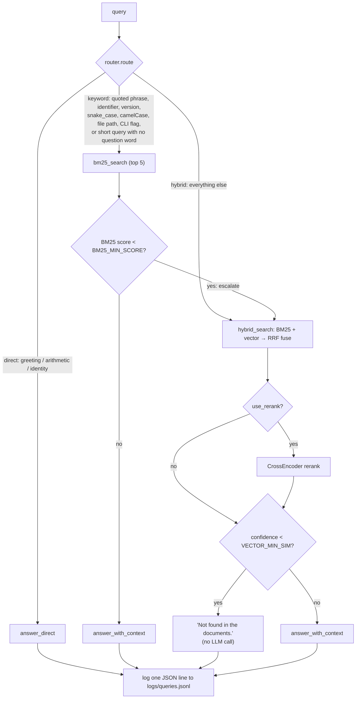

# AdaptiveRAG

A retrieval-augmented generation pipeline built from scratch — no LangChain,
LlamaIndex, or Haystack. A router classifies each query *before* any
retrieval happens, so cheap queries (greetings, arithmetic, "who are you")
skip retrieval entirely, exact-lookup-shaped queries (ticket IDs, version
numbers, file paths, quoted phrases) try BM25 first, and everything else
goes through hybrid (BM25 + vector) search fused with Reciprocal Rank
Fusion, with an optional cross-encoder reranking pass. A confidence
threshold on the retrieval side means the pipeline says "Not found in the
documents" instead of guessing when nothing relevant was actually retrieved.

Built as a from-scratch learning project — every piece (chunking, FAISS/BM25
indexing, RRF fusion, routing, confidence gating) is implemented directly
with `sentence-transformers`, `faiss-cpu`, `rank_bm25`, and `pypdf`, not a
RAG framework, so each part is easy to point at and explain.

## Architecture



Retrieval runs over small *child* chunks (~120 tokens) and each hit is
swapped for its larger *parent* chunk (~600 tokens) before generation
(`Retriever.to_parents`), so matching is precise but the LLM gets full
context. With reranking on, the cross-encoder scores a 30-candidate pool,
not just the final 5.

`answer_with_context` also normalizes an LLM reply of exactly `NOT_FOUND`
to the same "Not found in the documents." message, so a confidence miss
and a model-side miss look identical to the caller.

## Setup

```bash
# Use Python 3.10 (faiss-cpu / torch wheels aren't available for newer versions yet)
py -3.10 -m venv venv

# Windows
venv\Scripts\activate
# macOS/Linux
source venv/bin/activate

pip install -r requirements.txt

cp .env.example .env
# then edit .env: set LLM_PROVIDER, LLM_MODEL, API_KEY (Ollama needs no key)
```

This project uses Ollama as its LLM provider (see [DECISIONS.md](DECISIONS.md)).
Install Ollama separately and pull a model before running anything that
calls the LLM:

```bash
ollama pull llama3.1
```

## Running each step

```bash
# 1. Add PDFs to data/raw/, then chunk them (parent + child chunks)
python -m src.ingest            # writes data/index/parents.json, data/index/chunks.json (children)

# 2. Build the FAISS vector index and BM25 index over the child chunks
python -m src.indexer           # writes data/index/faiss.index, bm25.pkl, centroid.npy

# 3. Run the test suite
pytest -v

# 4. Evaluate against eval/questions.json (40+ real, user-supplied questions)
python -m src.eval              # writes eval/results.md, eval/to_grade.csv
python -m src.eval --llm-judge  # also adds an LLM-judged correctness score

# 5. Launch the UI
streamlit run app.py
```

## Retrieval methods, side by side

Qualitative top-3 comparison of each method on real questions from
`eval/questions.json`, captured on the **original 400-token index**. Chunk ids
changed when the corpus was re-chunked, so none are quoted; the measured
comparison on the current index is the hit@5 / MRR table further down.

**"How many problems are in the GSM8K dataset...?"** — all three methods
converge on the same few chunks (the dataset description in
`2110.14168v2.pdf`). Strong agreement when a fact is stated plainly once.

**"What was the best model's truthfulness on TruthfulQA...?"** — vector
and hybrid agree closely (all from `2109.07958v2.pdf`), but BM25 alone
drifts to different pages entirely — still the same paper, but further from
the actual answer. This is exactly the case fusion is for: BM25's lexical match
and vector's semantic match don't always agree, and RRF fusing both
landed closer to the vector result here.

**"What biases and limitations of LLM-as-a-judge are identified...?"**
— the corpus has two relevant papers (the original MT-bench/LLM-judge
paper, `2306.05685v4.pdf`, and a later survey, `2411.15594v6.pdf`).
Vector search pulls top hits from *both*; BM25's top hit is the first
paper's title page (lexically strong, substantively weak); hybrid
blends both papers' real content. A case where cross-document semantic
retrieval genuinely added value over pure keyword matching.

Full output (all 5 queries, all 3 methods) was captured during this
session; the three examples above are the representative patterns that
showed up across runs.

## Baseline demo (`git tag baseline-simple-rag`)

The simplest possible RAG — plain top-5 vector search, then generate,
no router, no fusion, no confidence gate — on 3 real questions:

**"What was the best model's truthfulness on TruthfulQA...?"** →
*"The best model, GPT-3-175B with a helpful prompt, produced 58% true
answers on TruthfulQA, which is lower than the human performance of
94%."* Correct, well-grounded — but `citations: []`. The model never
emitted a `[n]` marker at all, so citation parsing correctly found
nothing to extract; a good answer with no traceable source.

**"By how many percentage points does ARES beat RAGAS...?"** → *"[n]
59.9 percentage points on context relevance and 14.4 percentage
points on answer relevance."* The literal string `[n]` instead of a
real citation number — the model copied the prompt's template
placeholder verbatim rather than filling it in. (The 59.9 vs. the
`expected_answer`'s 59.3 is the same paper-internal inconsistency
noted in the historical evaluation section below, not a new error.)

**"Why does TruthfulQA find that larger models can be less
truthful?"** → *"[n3] According to the text, larger models generally
do worse... with the largest GPT-Neo/J being 17% less truthful than a
model 60x smaller."* Specific, correct, well-grounded content — with
`[n3]` as the citation marker instead of `[3]`.

All 3 answers are factually solid; 2 of 3 have a broken citation
format. This is the same small-model instruction-following gap the
full evaluation's correctness grading surfaced at scale — visible here in
just 3 examples, from the simplest baseline, before the router or
confidence gating ever enter the picture. (The literal `[n]` still shows up
in about 15% of current answers; see Limitations.)

## Parent-child chunking and the rerank fix

Two post-evaluation changes (rationale in `DECISIONS.md`), measured
**retrieval-only** (no LLM) on the 49 in-scope questions of the 55-question
set (the 6 `general` ones have no gold page). Before → after:

| Config | hit@5 | MRR |
|---|---|---|
| bm25 | 0.78 → 0.84 | 0.57 → 0.57 |
| vector | 0.63 → 0.76 | 0.44 → 0.52 |
| hybrid | 0.76 → 0.80 | 0.50 → 0.59 |
| hybrid+rerank | 0.76 → **0.90** | 0.63 → **0.68** |

`exact` questions on hybrid+rerank went 0.69 → 0.88.

- **Parent-child chunking.** Children (~120 tokens) are indexed; their
  parent (~600 tokens, never crossing a page) is what the LLM reads.
  Chosen over heading-based chunking because `pypdf` output from two-column
  papers has no reliable headings to split on.
- **Rerank bug.** The cross-encoder used to rerank only the 5 hits hybrid
  search had already picked, so it could never promote a better candidate,
  which is why `hybrid+rerank` matched `hybrid` exactly (0.76) in the first
  evaluation. It now reranks a 30-candidate pool.
- **Neighbor expansion is off by default.** Parents already supply the
  context it existed for; on top of them it adds at most +0.02 hit@5 while
  sending ~12 parents (~7k tokens) instead of 5 to a 3B model.
- **Thresholds re-calibrated** on the new index (`BM25_MIN_SCORE` 15,
  `VECTOR_MIN_SIM` 0.60, `RERANK_MIN_PROB` 0.5; `CENTROID_MIN_SIM` 0.55 still
  separates the groups). In-sample on the same 55 questions: sensible
  defaults, not held-out-tuned values.

### Full eval on the new index, plus a held-out set

The LLM-based eval was re-run end to end on the new index (llama3.2:3b via
Ollama). Because the 55 questions are also what the thresholds were tuned on,
I wrote a **held-out set** (`eval/heldout_questions.json`: 39 questions —
17 exact, 10 conceptual, 12 off-topic, two of them LLM-adjacent like "best LLM
today"). Every in-scope question's gold page is computed by regex-matching
evidence text in the PDF, not typed by hand. `python -m src.eval --questions
eval/heldout_questions.json` runs it and skips threshold tuning, so it stays
held out. I wrote these questions myself, so they may be friendlier than ones
written by a third party.

Correctness was graded by me (an AI session), not a human: exact questions by
whether the answer states the key fact, conceptual ones by reading against
`expected_answer`, off-topic ones by refusal (a normal reply on the `direct`
route counts as correct). A raw context dump that merely contains the number
counts as wrong. The graded per-answer files (`eval/to_grade_*graded.csv`) are
generated locally and git-ignored like the other `to_grade*.csv` files, so a
clone won't have them; re-run `python -m src.eval` to regenerate the answers.

**Original 55 questions, new index** (in-sample for thresholds):

| Config | hit@5 | correct, new (old chunking) |
|---|---|---|
| direct | 0.00 | 6/55 (5/55) |
| bm25 | 0.84 | 38/55 = 69% (53%) |
| vector | 0.76 | 41/55 = 75% (44%) |
| hybrid | 0.80 | 38/55 = 69% (44%) |
| hybrid+rerank | 0.90 | 43/55 = 78% (42%) |
| router (rerank on) | 0.88 | 43/55 = 78% |

The old column came from a different grading session with stricter rules for
formatting, so the size of the jump is not a clean like-for-like number.

**Held-out set** (the honest estimate): hit@5 and correct answers, in-scope
(27) / off-topic handled correctly (12):

| Config | hit@5 | in-scope correct | off-topic ok |
|---|---|---|---|
| direct | 0.00 | 0/27 | 12/12 |
| bm25 | 0.74 | 12 (44%) | 9 |
| vector | 0.67 | 14 (52%) | 9 |
| hybrid | 0.78 | 15 (56%) | 8 |
| hybrid+rerank | **0.93** | 16 (59%) | **12** |
| router (rerank on, fixed) | 0.93 | 16 (59%) | 11 |

hybrid+rerank is best on both sets and was the only config to refuse every
off-topic question in the first held-out run. Retrieval (hit@5 0.93) is far
ahead of answering (59%): the 3B model still returns bare citations, pastes
context, or answers from the wrong paper (e.g. MMLU-Pro when asked about MMLU).

**Run-to-run noise is large.** The same hybrid+rerank config scored 16/27 in
the first held-out run and 20/27 in the prompt A/B below, after I only added a
token cap and temperature 0. At 27 questions a gap of 3-4 answers is not a
real difference; the retrieval ranking is more trustworthy than the
correctness ranking.

**Bugs the eval found (all fixed, see `DECISIONS.md`):** one router answer ran
to ~209,000 characters (no output cap; fixed with `LLM_MAX_TOKENS=512` and
`LLM_TEMPERATURE=0`, which took router mean latency from 63 s to 21 s); the app
and eval `router` config ran without the reranker that stops off-topic
questions (reranking is now the default in both); and a reply of
`[1] [2] [3] NOT_FOUND` was not recognised as a refusal.

**Answer-prompt A/B** (hybrid+rerank, held-out set, same code and settings):

| Variant | in-scope (27) | bare-citation answers | off-topic ok (12) | total (39) |
|---|---|---|---|---|
| v1 original prompt | 20 | 2 | 11 | 31 (79%) |
| v2 reworded prompt + retry | 22 | 0 | 10 | 32 (82%) |
| **v1r original prompt + retry (default)** | 22 | 0 | 11 | **33 (85%)** |

v2's reworded prompt made the model answer two off-topic questions from the
corpus or its own knowledge, so I kept the original wording and only added a
single retry when a reply contains no words (a citation-only reply is never a
correct answer, so retrying it cannot cost accuracy). Differences between the
variants are within the noise above; `v1r` was chosen because it is the safest
by construction, not because the margin is proven.

## Original evaluation and what it taught (400-token chunking, historical)

This is the first full evaluation, run on the original flat 400-token chunks
(26 arXiv papers, 2,161 chunks, the same 55 questions, `llama3.2:3b`). It is
kept because the failures it exposed drove the later changes; for current
numbers use the sections above.

**hit@5 then** (the reranker only reordered 5 hits, which is why it matched
`hybrid`):

| Config | overall | conceptual | exact |
|---|---|---|---|
| bm25 | 0.78 | 0.88 | 0.72 |
| vector | 0.63 | 0.76 | 0.56 |
| hybrid | 0.76 | 0.88 | 0.69 |
| hybrid+rerank | 0.76 | 0.88 | 0.69 |
| router | 0.76 | 0.88 | 0.69 |

**Correctness then** (hand-graded by a separate session, 330 answers): bm25
53%, router 49%, vector 44%, hybrid 44%, hybrid+rerank 42%, direct 9%. The
gaps between configs were within noise; what mattered was that correctness sat
far below hit@5 because the model answered with a bare `[2]`, pasted a raw
table, or answered half of a two-part question while the right chunk was in
context. One grading note: for ARES the paper itself states both 59.3
(abstract) and 59.9 (results) for the same figure, so grading against a single
`expected_answer` string can't catch a source's own inconsistency.

**Neighbor expansion** (pull in each hit's adjacent chunks) raised hybrid hit@5
0.76 → 0.80 on the old chunks, all of it on `exact` questions. With
parent-child chunking it is redundant and costs ~12 parents per query instead
of 5, so it is off by default (see `DECISIONS.md`).

### The off-topic problem and the corpus centroid gate

The first threshold sweep showed `VECTOR_MIN_SIM=0.45` gave a **100%
false-answer rate on off-topic questions** when hybrid ran in isolation, and
the answers showed why it wasn't just a threshold problem:

- "What is the capital of France?" got `"Paris"` from `bm25`, only because one
  paper contains that exact benchmark example. BM25 matched on text overlap,
  not topic.
- A corpus of papers *about* evaluating LLMs is full of example Q&A and
  jailbreak-shaped text that lexically resembles almost any casual query, and a
  3B model often completes or echoes retrieved example text instead of
  refusing (one `bm25` answer devolved into an all-caps rant lifted from a
  jailbreak test string).
- `hybrid` sometimes ignored "answer only from context" and used its own
  knowledge (an actual ocean poem, real Mumbai weather).

The router's regex can't tell a well-formed off-topic question from a real
one, so the fix needed a different signal: compare the query with the whole
corpus's average embedding (`Retriever.centroid_similarity`) instead of any
single chunk. On the 55 questions, off-topic ones scored 0.44-0.59 and
in-scope ones 0.59-0.78; `CENTROID_MIN_SIM=0.55` was set from that gap (and
re-checked after the index was rebuilt). Before/after:

| Question | Before | After |
|---|---|---|
| "What is the capital of France?" | `bm25` answered "Paris" | Not found |
| "Can you write me a poem about the ocean?" | `hybrid` wrote a poem | Not found |
| "What's the weather like in Mumbai?" | `hybrid` described real climate | Not found |
| "Who won the FIFA World Cup in 2022?" | garbled unrelated content | Not found |

On the held-out set (above) the final pipeline handles 11-12 of 12 off-topic
questions; the misses are model-side (it answers a code question from its own
knowledge, or returns a bare citation), not retrieval. The reranker is what
makes the biggest difference there: the same retrieval without it refused
8 of 12.

**What worked:** the router never needed to escalate a strong keyword match,
and `direct` costs almost nothing (mean ~4-5 s vs ~17-25 s for anything that
retrieves). **Latency note:** the old run's latency numbers were distorted by
memory pressure from other applications; in the later runs on an otherwise idle
machine, retrieval configs averaged ~17-25 s per question and the router ~21 s.

## Limitations

- The automated test suite still runs against small synthetic fixtures
  (not the real corpus) for speed and determinism; the real corpus is
  only exercised by `python -m src.eval` and manual use.
- Chunking's paragraph-boundary detection depends on the PDF text
  extraction preserving blank-line breaks, which many PDFs don't encode;
  in practice, chunking mostly falls through to the sentence-boundary
  step (see `DECISIONS.md`).
- Token counts are approximate (`word count × 1.3`), not an exact match
  for any specific model's tokenizer.
- Confidence thresholds (`BM25_MIN_SCORE`, `VECTOR_MIN_SIM`,
  `RERANK_MIN_PROB`, `CENTROID_MIN_SIM`) were re-calibrated on the
  parent-child index using the same 55 questions the evaluation reports
  on — no held-out split, so answer-rate and false-answer figures are
  optimistic. Per-chunk thresholds alone can't separate off-topic
  questions (their scores overlap in-scope ones); the centroid gate and
  the reranker carry that.
- A corpus of papers *about* LLM evaluation/benchmarks/jailbreaks
  contains example Q&A pairs and adversarial prompt text as part of its
  normal content — retrieval can surface this for an unrelated query,
  and the local 3B model sometimes completes or echoes it instead of
  refusing. This is a property of this specific corpus choice, not a
  general flaw in the pipeline.
- The router's patterns are heuristics, not a learned classifier — e.g. a
  mixed-case proper noun (like a product name) inside an otherwise
  conceptual question can trigger the `camel_case_token` keyword rule.
  This is tolerated by design: the keyword route escalates to hybrid
  automatically on a weak BM25 match.
- The prompt tells the model to cite with "[n]", and it sometimes copies that
  literally (7 of 46 non-refusal router answers on the 55-question set),
  so those answers carry no parseable citation. The reworded v2 prompt avoided
  this but loosened refusals (see the A/B); a minimal fix like "e.g. [2]" in the
  v1 wording has not been measured.
- Generation quality, not retrieval, is the main ceiling: hit@5 is ~0.93 on the
  held-out set but only ~59% of in-scope answers are correct with the 3B model.
  There are no confidence intervals, the held-out set is small (39) and was
  written and graded by the assistant, and the same config varied by 4 answers
  between two runs.
- Reranking lazily loads `BAAI/bge-reranker-base` (~1GB); the first call
  that uses it is slow, and it now scores 30 candidates per query.
- Only one LLM provider is implemented (`ollama`); switching providers
  means implementing a new branch in `src/llm.py`, not just an env var.
- No authentication, concurrency control, or deployment hardening — this
  is a learning project, not a production service.

## Related work

- **[adaptive-rag-engine](https://pypi.org/project/adaptive-rag-engine/)**
  (PyPI) — a FastAPI service built on LangChain that dynamically routes
  each query to dense (FAISS + SentenceTransformers), sparse (BM25), or
  RRF-fused hybrid retrieval based on query analysis, followed by
  cross-encoder reranking and a confidence estimator, generating with
  Google Gemini.
- **[ArgusLens](https://github.com/R-Sreenivas-Raju/ArgusLens)** — a RAG
  system for banking document Q&A. A regex-based intent classifier routes
  each query down a deterministic path (rule-based extraction for
  structured questions like eligibility checks, no LLM involved) or an
  LLM path (query condensation, then BM25+FAISS hybrid retrieval fused
  with RRF via LangChain's `EnsembleRetriever`, then a BGE cross-encoder
  rerank, then a Gemini chain with chat memory).
- **[Augur](https://github.com/willgitdata/augur)** — a TypeScript
  (`@augur-rag/core`) adaptive retrieval layer sitting on top of a vector
  database. For each query it picks vector search, BM25, weighted
  hybrid, or vector-then-rerank using inexpensive query-feature
  heuristics, and returns an explainable routing trace (decision,
  reasons, timing) with every response.

**What this project does differently:** all three route *between*
retrieval strategies, but none appear to route *out of* retrieval
entirely — AdaptiveRAG adds a **direct route with no retrieval at all**
for queries that don't need the document corpus (greetings, arithmetic,
"what can you do"), so those never touch the index or spend retrieval
latency. It also adds an explicit **confidence-based fallback**: the
keyword route escalates to hybrid retrieval on a weak BM25 match, and the
hybrid/vector path returns "Not found in the documents" — without calling
the LLM at all — when retrieval confidence falls below a threshold, rather
than letting the LLM attempt an answer from weak context. These are
modest, specific additions on top of the same core idea (strategy
routing) these other projects already explore; see the held-out table above
for how the router actually compares to each strategy run in isolation. On
this corpus it ties hybrid+rerank on accuracy (16/27 held-out, 43/55 on the
original set) and mainly saves latency on `direct` and keyword queries.

---

See [DECISIONS.md](DECISIONS.md) for the reasoning behind every choice
not pinned down by the project spec, logged step by step as the project
was built.
